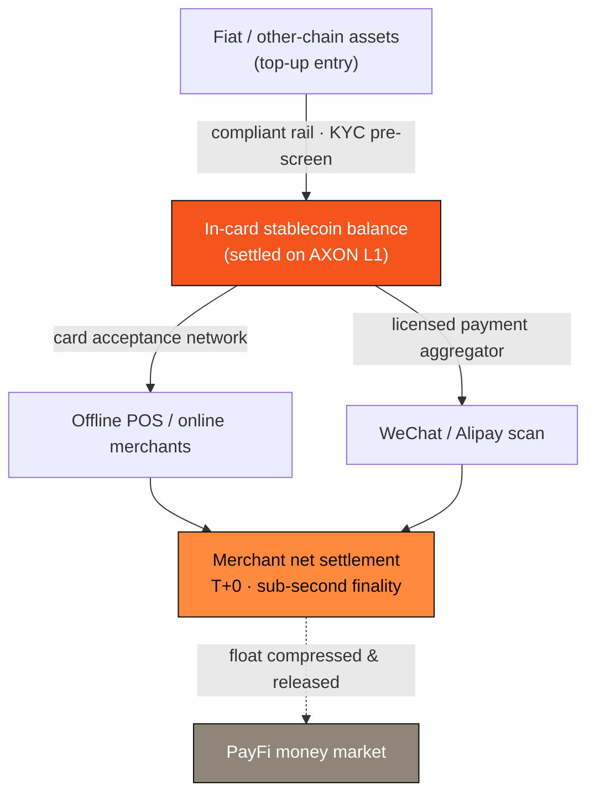

# 4.6 The Crypto U-Card: Top-up, Spend, Bind WeChat/Alipay

[4.5 The US-Equity Copy-Trading Engine](4-5-copy-trading-engine.md) brought external traffic into AXON's **open ecosystem**. From this section onward we cover the other leg — **AXON's own first-party consumer product matrix**: it takes the settlement capabilities honed in Part III and Part IV and lays them all the way into the user's pocket, daily life, and social graph, carrying the "foundation-first, product-wedge" strategy from infrastructure to everyday use by hundreds of millions.

The first piece of this product line is the **Crypto U-Card** — a two-way gate between the fiat world and on-chain stablecoins. It is **PayFi 1.0** of AXON's second ecosystem, the **PayFi payment ecosystem**: following the first open ecosystem (the copy-trading engine, i.e. Ecosystem 1, already open), the PayFi ecosystem takes its first step here (see the ecosystem-opening arc in [6.1](../part6-roadmap/6-1-roadmap.md)).

> **The Crypto U-Card turns on-chain stablecoins into purchasing power in your pocket — it is the last mile of AXON's settlement rail ([4.1](4-1-settlement-rail.md)) reaching real-world spending.**

No matter how fast or deterministic an on-chain stablecoin is, as long as it can't be scanned at a convenience store or swiped at a café, it remains "numbers on a screen" for ordinary people. The U-Card solves exactly this "last mile": it packages the T+0, sub-second-finality settlement of [4.1](4-1-settlement-rail.md) into a card that can be spent directly across global acceptance networks and local scan-to-pay scenarios.

## Three Capabilities: Top-up · Spend · Bind WeChat/Alipay

**① Top-up** — users load the card with fiat or other-chain assets, converted through a compliant rail into an in-card stablecoin balance settled on AXON L1. The on-chain network cost is sponsored by the Paymaster of [3.7](../part3-architecture/3-7-account-abstraction.md), so users need not hold a gas token — or even understand that a chain exists. The effective purchasing power a user actually receives after one top-up is

$$P_{\text{eff}} = A_{\text{topup}} \times (1 - s) - f_{\text{gas}}, \qquad f_{\text{gas}} \to 0$$

where $A_{\text{topup}}$ is the top-up amount, $s$ is the conversion spread, and $f_{\text{gas}}$ is the on-chain network fee. Paymaster sponsorship drives $f_{\text{gas}} \to 0$, so purchasing power is affected almost only by the conversion spread.

**② Spend** — the in-card stablecoin balance can be swiped across card acceptance networks and checked out at supported online merchants. Unlike the traditional card model of "authorize first, clear later" over T+1–T+3, the fund movement on the AXON side reaches finality within sub-seconds ([3.4](../part3-architecture/3-4-payment-finality.md)). For a purchase of amount $A$, the merchant's net settlement is

$$S_{\text{net}} = A \times (1 - \text{MDR})$$

where $\text{MDR}$ (merchant discount rate) covers acceptance and compliance costs; the on-chain clearing cost itself approaches zero.

**③ Bind WeChat/Alipay** — through a **licensed payment aggregator**, the U-Card can be bound to local scan-to-pay scenarios such as WeChat and Alipay, letting users "scan and spend their on-chain balance" in everyday commerce. This layer always runs through licensed aggregators as the channel, with the pluggable compliance gateway of [3.6](../part3-architecture/3-6-compliance-gateway.md) (KYC/AML, geofencing, risk pre-screening) as the prerequisite — compliance built in as a foundation capability, not bolted on afterward.

## Compressed Float, Returned as Ecosystem Yield

The settlement lag of traditional card networks deposits enormous float in the system. For a card network with daily volume $\text{TPV}$ and an average settlement cycle $\Delta t_{\text{settle}}$, the in-transit float is roughly

$$\Phi \approx \text{TPV} \times \Delta t_{\text{settle}}$$

The traditional system stretches $\Delta t_{\text{settle}}$ to 1–3 days, and the time value of this float is mostly consumed by intermediaries. The AXON U-Card compresses $\Delta t_{\text{settle}}$ to near zero — the funds squeezed out, and those still cycling in the system, can transparently enter the [4.2 PayFi Money Market](4-2-money-market.md) and capture real time value per the $Y_{\text{float}} = \Phi \times r \times \tfrac{t}{365}$ of [4.4](4-4-time-value-of-money.md), with yield distributed transparently rather than quietly pocketed. **The U-Card is not merely a spending outlet; it is simultaneously an inlet that injects real payment flow into the PayFi money market.**

## How Value Returns to the L1

Every purchase the U-Card generates is a stream of real on-chain payment flow (TPV). At the protocol fee rate it feeds into the value-capture loop of the [7.3 Deflationary Flywheel](../part7-tokenomics/7-3-utility-flywheel.md): real spending → protocol fees → buyback-and-burn. The more users and the more frequently they swipe, the thicker the real value settled into the L1 — this is the first realization of "empowering the chain" at the consumption layer.

> **Scope note**: This section is a `proposed design` within AXON's ecosystem application matrix, corresponding to roadmap stages P1 (closed beta) → P2 (scale-up) (see [6.1](../part6-roadmap/6-1-roadmap.md)). The U-Card is a payment and spending tool and **promises no cashback, yield, or wealth-management return**; top-up/conversion/acceptance rates and card-issuance and regional availability are subject to the final compliant launch terms, `TBD / governance-set`. WeChat- and Alipay-related capabilities are all delivered through licensed, compliant payment aggregators.

---

*Further reading: [4.1 Instant Stablecoin Settlement Rail](4-1-settlement-rail.md) · [3.6 Pluggable Compliance Gateway](../part3-architecture/3-6-compliance-gateway.md) · [4.7 AXON Wallet App](4-7-wallet-app.md)*
