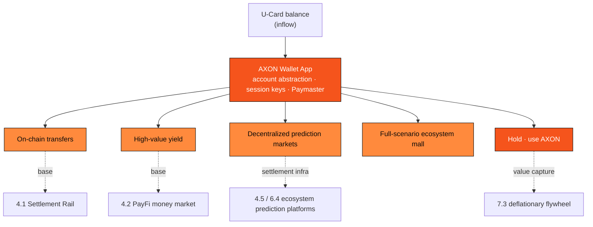

# 4.7 AXON Wallet App: On-Chain Transfers, High-Value Yield, Decentralized Prediction Markets

The U-Card of [4.6](4-6-u-card.md) (PayFi 1.0) turned fiat into an on-chain stablecoin balance inside the card. But a card can only "spend," not "use" — it cannot let the balance transfer, earn, or participate in on-chain markets. **The AXON Wallet App is the hub that activates the U-Card balance into programmable on-chain capital**: it is the operating system for the entire ecosystem product line, and the single door an ordinary user needs to open between themselves and AXON L1.

Together with **full-scenario ecosystem-mall commerce**, the Wallet App forms **PayFi 2.0** of AXON's second ecosystem, the **PayFi payment ecosystem** — if the U-Card (PayFi 1.0) solved "how a single card is spent," then PayFi 2.0 solves "how the balance is actually put to use across every scenario."

> **The AXON Wallet App turns the idle balance in your U-Card into programmable on-chain capital that can transfer, earn, and participate in markets — it is the super-app hub of the AXON ecosystem.**

The Wallet is built on [3.7 Account Abstraction, Session Keys & Paymaster](../part3-architecture/3-7-account-abstraction.md): what the user sees is a familiar balance and a "one-click" button, while underneath is an account-abstraction wallet, session-key authorization, and fee sponsorship — **no seed-phrase burden, no gas awareness, sub-second finality**. It gathers on-chain transfers, high-value yield, prediction markets, full-scenario ecosystem-mall commerce, and even the holding and use of the mother token AXON into a single account entry point — making it a **bank-grade, one-stop financial super-app**: just as a digital bank packs accounts, wealth management, payments, and lifestyle services into one App, the AXON Wallet packs the entire PayFi ecosystem into one entry point. Its core capabilities follow.

## 1. On-Chain Transfers: Value Movement in Seconds, Without Gas Friction

Transfers are the Wallet's most basic and most frequent capability, directly reusing [4.1 Instant Stablecoin Settlement Rail](4-1-settlement-rail.md): pay to an address or a human-readable name, with sub-second finality and 24/7 global arrival. Gas is sponsored by the Paymaster, so the user-side cost of a transfer is approximately

$$C_{\text{user}} = f_{\text{spread}} + \underbrace{f_{\text{gas}}}_{\to 0 \,(\text{Paymaster})} \approx f_{\text{spread}}$$

That is, on the user side a transfer is almost "all intent, no friction" — precisely the experience dividend earned by building [3.4 Payment Finality](../part3-architecture/3-4-payment-finality.md) into the foundation.

## 2. High-Value Yield: Real-Payment-Flow Earning on Idle Stablecoins

**Yield** inside the Wallet is, in essence, the earning capability of the [4.2 PayFi Money Market](4-2-money-market.md) delivered to ordinary users through a "one-click" interaction: the user places idle stablecoins into the PayFi money market / float pool, and shares accrue by **net asset value (NAV)**. If the realized return over interval $i$ is $r_i$ with duration $\Delta t_i$, NAV accrues as

$$NAV_t = NAV_0 \cdot \prod_i \left(1 + r_i \, \Delta t_i\right)$$

Here $r_i$ **is not a promised fixed number**, but a realized return that is endogenous to the underlying real payment flow and floats with the market — its legitimacy comes from [4.4 The Time Value of Money](4-4-time-value-of-money.md): the time-value premium that funding demanders pay for "getting cash early." The yield is rooted in real receivables and payment flow, not in newcomers' principal, **ruling out any Ponzi structure by design**; risk is guarded jointly by the risk-control waterfall of [4.2](4-2-money-market.md) (deposit → reserve → absorb tier by tier) and the price-feed safety of [3.5](../part3-architecture/3-5-oracle-safety.md).

> **Scope note**: The yield feature is a retail interface to money-market returns. $r_i$ is a **floating, endogenous, non-promised** realized return; the Wallet **offers no principal-protection, floor, fixed-APY, or "guaranteed-profit" wording**; returns may fluctuate with market and default conditions, principal is at risk, and specific product parameters are `TBD / governance-set`.

## 3. Decentralized Prediction Markets: AXON Settles, Ecosystem Platforms Host

Inside the Wallet, users connect directly to the decentralized prediction platforms in AXON's **open ecosystem** (Polymarket, Kalshi, Kairos, **etc.**, see [4.5](4-5-copy-trading-engine.md), [6.4](../part6-roadmap/6-4-ecosystem-season.md)): users participate in event markets with stablecoins, while **the finality of every wager, payout, and settlement lands on AXON L1**. This clarifies a boundary — **AXON is the settlement infrastructure and account base for these markets; the prediction platforms are ecosystem participants; AXON does not self-operate betting and does not act as the house.**

Mechanically, for a prediction market run by an automated market maker (LMSR, the Logarithmic Market Scoring Rule), the market-making cost function and outcome pricing are

$$C(\vec q) = b \ln \sum_i e^{q_i / b}, \qquad p_i = \frac{e^{q_i / b}}{\sum_j e^{q_j / b}}$$

where $\vec q$ is the position vector across outcomes and $b$ is the liquidity parameter. The $p_i$ form exactly a set of probabilities summing to 1 — **the price in a prediction market is the crowd's consensus on the probability of an event.** AXON's value is not in defining these markets, but in providing them a sub-second-final, double-spend-resistant, auditable settlement layer: letting "consensus pricing" run, for the first time, on a deterministic foundation built for payments.

## The Full-Scenario Ecosystem Mall: Spending Across Every Scenario

If the U-Card brought stablecoins to offline swiping and local scan-to-pay, the **full-scenario ecosystem mall** extends the spending radius further to the full range of in-ecosystem goods and services — from digital goods and subscriptions to physical retail from ecosystem-partner merchants. Users check out in one click with the stablecoin balance in their Wallet, settled with sub-second finality on AXON L1 ([4.1](4-1-settlement-rail.md)), with gas sponsored by the Paymaster.

The mall closes the last gap between "holding stablecoins" and "using stablecoins": a mall purchase of gross value $G$ converts directly into real on-chain payment flow, contributing fees $\text{Fee} = G \times \tau$ at the protocol rate $\tau$ into the [7.3 Deflationary Flywheel](../part7-tokenomics/7-3-utility-flywheel.md). **The U-Card handles inflow and offline spending, the mall handles full-scenario in-ecosystem commerce, and the Wallet puts the balance to work — the three together are the complete PayFi 2.0.**

## The Mother Token AXON: The Ecosystem's Native Currency, Held and Used in the Wallet

A complete financial super-app also needs a native currency that ties the whole ecosystem together — the mother token **AXON** (see [Part VII Tokenomics](../part7-tokenomics/README.md)). The Wallet App is precisely the entry point where users **hold and use AXON**: in the wallet, users can hold AXON and put it to work across the ecosystem — **paying on-chain fees with AXON for tiered discounts, staking AXON to participate in network security and governance, and posting it as a reputation bond for PayFi and AI-agent scenarios**.

Here AXON is not an isolated speculative asset, but the **ecosystem's native currency and rights certificate**: the real fees generated by U-Card spending, mall transactions, yield, and transfers are used to buy back and burn AXON through the [7.3 Deflationary Flywheel](../part7-tokenomics/7-3-utility-flywheel.md) — **the more it is used across the ecosystem, the faster the flywheel spins.** This directly connects "a user's everyday financial actions in the wallet" with "the long-term value capture of the mother token": stablecoins handle liquidity and spending, while AXON carries the security, governance, and value reflux of the entire ecosystem.

> **Scope note**: This section describes AXON's **utility and holding / use scenarios**, and does **not touch price, market cap, issuance, or investment return**; the token's allocation, unlock, and circulation terms follow [Part VII](../part7-tokenomics/README.md), with initial price / FDV / TGE circulation not disclosed. Holding and using AXON carries market and compliance risk; availability is subject to compliant launch terms.

## Four-in-One: The Wallet Lets Value Circulate Within the Ecosystem

Once transfers, yield, prediction, mall commerce, and the holding and use of the mother token AXON are unified under one account, capital can flow frictionlessly within the ecosystem: U-Card inflow → Wallet transfer/yield → earn while idle → participate in prediction markets → mall spending → settle back into a stablecoin balance → spend again, with the fees generated along the way buying back and burning AXON through the flywheel. Each hop is a stream of real TPV, feeding into the [7.3 Deflationary Flywheel](../part7-tokenomics/7-3-utility-flywheel.md) at the protocol fee rate. **The Wallet is not a collage of a few features, but the hub that keeps value circulating within the AXON ecosystem and continuously settling real business volume into the L1 and the mother token AXON.**

> **Scope note**: This section is a `proposed design`, corresponding to roadmap stages P1 (transfers + yield MVP) → P2 (money-market scale-up, prediction-market direct connection) ([6.1](../part6-roadmap/6-1-roadmap.md)). Prediction markets are hosted by ecosystem platforms with AXON providing settlement infrastructure, not self-operated by AXON; regional availability of these features is subject to compliant launch terms.

---

*Further reading: [4.2 PayFi Money Market](4-2-money-market.md) · [4.5 The US-Equity Copy-Trading Engine](4-5-copy-trading-engine.md) · [4.8 The Financial-Social Ecosystem](4-8-financial-social.md)*
