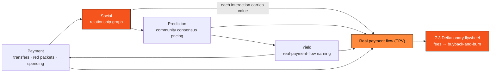

# 4.8 The Financial-Social Ecosystem: A Complete Financial-Social Loop

The U-Card ([4.6](4-6-u-card.md)) solved "how money comes in and how it's spent"; the Wallet ([4.7](4-7-wallet-app.md)) solved "how money transfers, earns, and participates in markets." The last piece is to wire these otherwise isolated financial actions into the **network of relationships between people** — this is AXON's **financial-social ecosystem**, the outermost and most imaginative ring of the entire product line.

This section covers the two highest tiers of AXON's ecosystem arc: **Ecosystem 3 · the financial-social super-ecosystem** — fusing finance and social into one settlement layer; and **Ecosystem 4 · the chat-social app** — closing that ecosystem into a standalone product, the most long-range tier (see the ecosystem-opening arc in [6.1](../part6-roadmap/6-1-roadmap.md)).

> **Payment is, at its root, the primitive of social interaction.** Money moving between people already draws a graph of relationships — who paid whom, who copy-traded whom, who sits in the same prediction circle. What AXON sets out to do is liberate that graph from the silos of individual apps and let it grow directly on a settlement layer built for payments.

In the traditional world, social (WeChat, Instagram) and finance (banks, brokerages) are two severed systems: relationships live in one app, money in another. But when payment itself becomes a sub-second-final, gas-free atomic operation ([4.1](4-1-settlement-rail.md), [3.7](../part3-architecture/3-7-account-abstraction.md)), social and finance can, for the first time, fuse within one layer — **every interaction can carry value, and every flow of value is inherently social.**

## Four Forms of Financial-Social

* **Social transfers / red packets / tipping** — turning P2P payment into a form of social expression: red packets in a group, tips to creators, splitting a bill among friends. It is a social wrapper on the payment primitive, not betting.
* **Copy-trading and strategy sharing** — the [4.5 US-Equity Copy-Trading Engine](4-5-copy-trading-engine.md) is a natural social amplifier: users can follow, share, and discuss strategy performance across the social graph, letting the first wave of "foundation-first, ecosystem-wedge" traffic spread naturally along relationship chains.
* **Community consensus in prediction markets** — the prediction markets of [4.7](4-7-wallet-app.md) ([4.5](4-5-copy-trading-engine.md)/[6.4](../part6-roadmap/6-4-ecosystem-season.md)) are, in essence, a crowd pricing events, and community is their most natural carrier: opinions collide within circles, consensus is priced on-chain.
* **Shared yield within circles** — placing the earning capability of the [4.2 Money Market](4-2-money-market.md) into a community context, letting a group participate together in real-payment-flow yield transparently and auditably (yield terms as in [4.7](4-7-wallet-app.md): floating, non-promised).

## Four-in-One: The Loop of Payment · Yield · Prediction · Social

Payment brings relationships; relationships bring prediction and yield; financial behavior in turn deepens the stickiness of relationships — the four are each other's entry points, mutually reinforcing, forming a loop that keeps turning on its own. And every turn of that loop settles real business volume into AXON.

## Network Effects: Why Social Is the Amplifier of Value

The value of financial-social comes from network effects. A network with $n$ active financial relationships has value that can be characterized by a conservative Metcalfe variant:

$$V \propto n \log n$$

That is, growth in user base yields **super-linear** growth in network value — precisely the mathematical intuition behind "social empowers the chain": each additional user brings not just one more instance of spending, but a whole ring of potential value flows with existing users.

This amplification shows up directly at the flywheel's inlet. The incremental fees contributed by the social layer are

$$\text{Fee}_{\text{social}} = \text{TPV}_{\text{social}} \times \tau$$

where $\text{TPV}_{\text{social}}$ is the payment flow driven by social scenarios and $\tau$ is the protocol fee rate. It flows into the [7.3 Deflationary Flywheel](../part7-tokenomics/7-3-utility-flywheel.md) together with the TPV of U-Card spending, Wallet yield, and transfers. If we further characterize propagation with a growth model, the viral coefficient (K-factor) of social spread can be written $K = i \times c$ (with $i$ invitations per user and $c$ the conversion rate); when $K > 1$, the network enters a self-growth regime — this is a **forward-looking growth assumption** used to illustrate the leverage the social layer gives ecosystem scale, not a promise of any kind.

## Ecosystem 4 · The Chat-Social App: Closing Financial-Social into One Product

The capabilities of financial-social can first be built into the Wallet and the ecosystem mall (Ecosystem 3); but their complete form is a **standalone chat-social app** — the most long-range tier of AXON's ecosystem arc (Ecosystem 4). In this product, chatting and transferring are the same action, groups and bill-splitting are the same interface, the relationship graph and the money flow are the same graph: **sending a message can carry a transfer, creating a group can open a shared yield pool or a prediction, following someone can copy-trade them.** Finance is no longer another app beside social — it is a form of social expression itself.

This tier gathers the payment, spending, yield, and prediction capabilities accumulated by the earlier tiers into a single people-centered entry point, truly building the user's **complete financial-social ecosystem** and putting a period on the entire arc. As the most long-range plan, it is presented as a `proposed design`, corresponding to roadmap stage P3+ ([6.1](../part6-roadmap/6-1-roadmap.md)).

## The Complete Ecosystem: From Foundation to Super-App

With this, AXON's narrative closes into a complete arc: **the L1 foundation (Part III) → the PayFi engine (4.1–4.4) → Ecosystem 1 · copy-trading (4.5) → Ecosystem 2 · PayFi payments (U-Card · mall · Wallet, 4.6–4.7) → Ecosystems 3 / 4 · financial-social and chat-social (4.8)**. The foundation builds determinism into the base, the engine brings time value on-chain, and each tier of ecosystem delivers all of it into the pockets, daily lives, and relationships of hundreds of millions. Financial-social is the closing of that arc — it makes AXON not merely a chain, but a **complete financial-social ecosystem uniting payment, yield, prediction, and social into one**, continuously empowering the mother token AXON.

> **Scope note**: This section is the most long-range `proposed design` in the entire product line, corresponding to roadmap stage P3+ ([6.1](../part6-roadmap/6-1-roadmap.md)). Social transfers/red packets/tipping are social expressions of the payment primitive, **not betting and not yield products**; copy-trading and yield sharing follow the compliance terms of [4.5](4-5-copy-trading-engine.md)/[4.7](4-7-wallet-app.md) (floating, non-promised, Ponzi-excluded); $V \propto n\log n$ and the K-factor are **design assumptions / forward-looking models** used to illustrate network effects, and do not constitute any growth or yield promise.

---

*Further reading: [7.3 Token Utility & the Deflationary Flywheel](../part7-tokenomics/7-3-utility-flywheel.md) · [6.1 Roadmap P0 → P3+](../part6-roadmap/6-1-roadmap.md) · [Part V · AI-Native](../part5-ai/README.md)*
