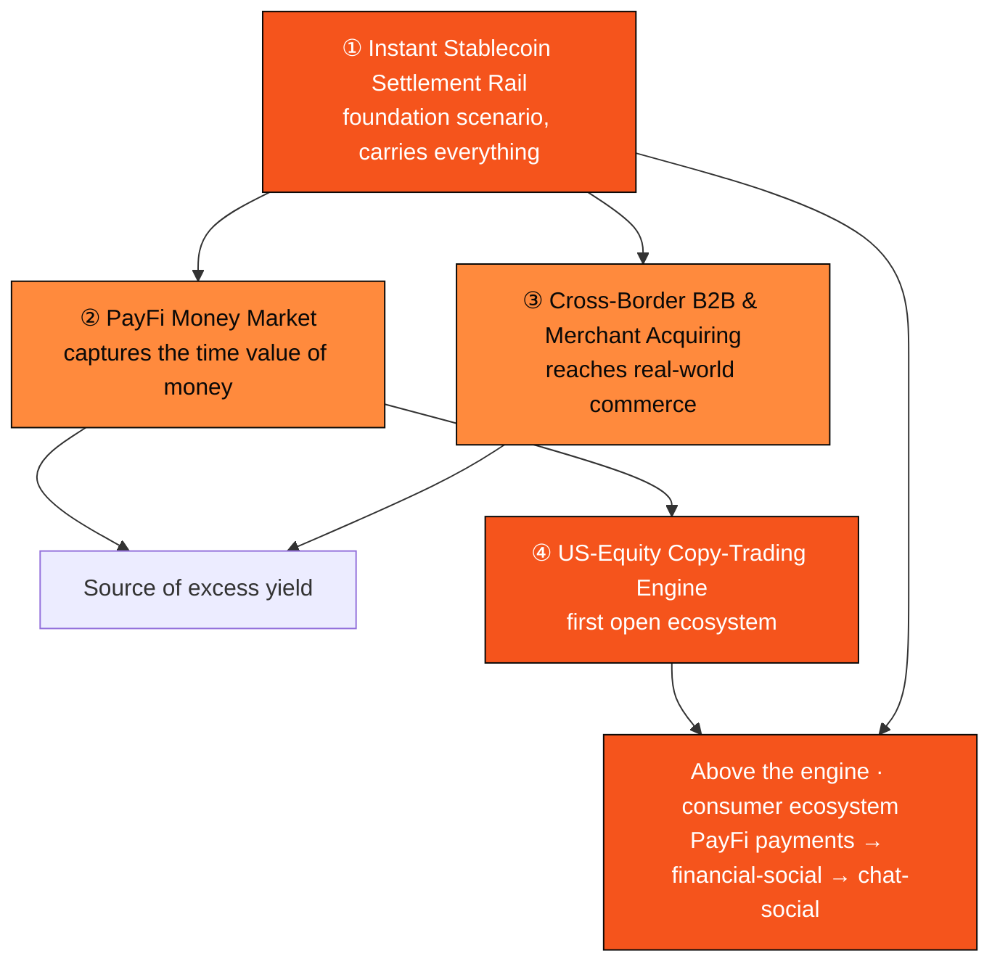

# Part IV · The PayFi Engine

> One payment rail as the foundation; four scenarios stacking value on top.

Part III built the foundation. This part shows the business that grows on top of it: **PayFi's four scenarios**, and, above the engine, the **consumer super-app matrix.**

These four scenarios are not four parallel features but a **layered value structure** — at the bottom is the settlement rail, which carries everything; on top of it stacks the money market, capturing time value; then cross-border and merchant scenarios, reaching real-world commerce; and AI-agent payments (Part V) run through them all, becoming the way of paying in the machine age.

And above these four scenarios, AXON unfolds an entire consumer ecosystem for hundreds of millions of users, tier by tier, **in the order ecosystems open**: **Ecosystem 1** is the first open ecosystem — the already-open **US-equity copy-trading engine** ([4.5](4-5-copy-trading-engine.md)); **Ecosystem 2** is the **PayFi payment ecosystem** — 1.0 being **Crypto U-Card payments** ([4.6](4-6-u-card.md)), 2.0 being **full-scenario ecosystem-mall commerce + the AXON Wallet App** ([4.7](4-7-wallet-app.md)); and above that, **Ecosystem 3 · the financial-social super-ecosystem** and **Ecosystem 4 · the chat-social app** ([4.8](4-8-financial-social.md)). If 4.1–4.5 build value into the foundation and the engine, then 4.6–4.8 carry that value all the way into the user's pocket, daily life, and relationships — taking "foundation-first, product-wedge" from infrastructure to everyday use. For the full arc of ecosystem openings and their mapping to stages, see [6.1 Roadmap](../part6-roadmap/6-1-roadmap.md).

The chapter map for this part:

* **4.1** Instant Stablecoin Settlement Rail — the foundation scenario that carries everything.
* **4.2** PayFi Money Market — float and on-chain credit, PayFi's source of excess yield.
* **4.3** Cross-Border B2B & Merchant Acquiring — bringing PayFi to real-world commerce.
* **4.4** The Finance of the Time Value of Money — the financial first principle underpinning it all.
* **4.5** The US-Equity Copy-Trading Engine — **Ecosystem 1**: AXON's first open ecosystem (already open), turning the above foundation into a market-facing landing scenario.
* **4.6** The Crypto U-Card — **Ecosystem 2 · PayFi 1.0**: turning on-chain stablecoins into purchasing power in your pocket, the last mile to real-world spending.
* **4.7** AXON Wallet App — **Ecosystem 2 · PayFi 2.0**: full-scenario ecosystem-mall commerce plus the super-app hub, three-in-one across on-chain transfers, high-value yield, and decentralized prediction markets.
* **4.8** The Financial-Social Ecosystem — **Ecosystems 3 / 4**: a financial-social super-ecosystem uniting payment, yield, prediction, and social, extending to a standalone chat-social app that closes the complete loop.
