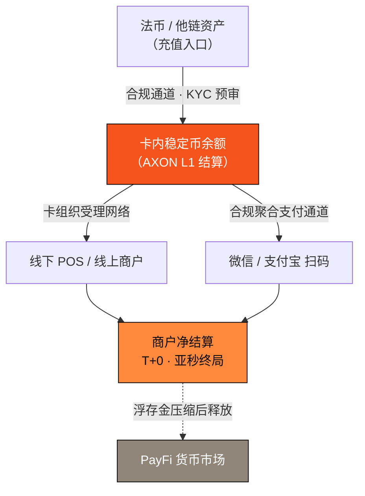

# 4.6 Crypto U 卡：充值 · 消费 · 绑定微信支付宝

[4.5 美股带单引擎](4-5-copy-trading-engine.md) 把外部流量接进了 AXON 的**开放生态**。从本节起，我们讲另一条腿——**AXON 自己长出来的第一方消费级产品矩阵**：它们把 Part III、Part IV 打磨出的结算能力，一路铺到用户的口袋、日常与社交里，让「地基先行、产品切口」的战略从基建走向亿级用户的日用。

这条产品线的第一块拼图，是 **Crypto U 卡**——法币世界与链上稳定币之间的双向闸门。它是 AXON 第二个生态 **PayFi 支付生态的 1.0**：继首个开放生态（带单引擎，即生态一，且已开放）之后，PayFi 生态从这里迈出第一步（生态开放弧线见 [6.1](../part6-roadmap/6-1-roadmap.md)）。

> **Crypto U 卡把链上稳定币变成口袋里的购买力——它是 AXON 结算 Rail（[4.1](4-1-settlement-rail.md)）触达现实世界消费的最后一公里。**

链上稳定币再快、再确定，只要还不能在便利店扫码、在咖啡馆刷卡，它对普通人就仍是「屏幕里的数字」。U 卡要解决的，正是这「最后一公里」：把 [4.1](4-1-settlement-rail.md) 的 T+0、亚秒最终性结算能力，包装成一张可以在全球受理网络与本地扫码场景里直接花出去的卡。

## 三种能力：充值 · 消费 · 绑定微信/支付宝

**① 充值**——用户以法币或他链资产为卡充值，经合规通道兑换为卡内稳定币余额，结算落在 AXON L1。链上一侧的网络成本由 [3.7](../part3-architecture/3-7-account-abstraction.md) 的 Paymaster 代付，用户无需持有 gas 代币、也无需理解链的存在。一次充值后用户实际获得的可用购买力为

$$P_{\text{eff}} = A_{\text{topup}} \times (1 - s) - f_{\text{gas}}, \qquad f_{\text{gas}} \to 0$$

其中 $A_{\text{topup}}$ 是充值金额、$s$ 是兑换点差、$f_{\text{gas}}$ 是链上网络费。Paymaster 代付使 $f_{\text{gas}} \to 0$，用户的购买力几乎只受兑换点差影响。

**② 消费**——卡内稳定币余额可在卡组织受理网络刷卡、在支持的线上商户结账。与传统卡「授权在前、清算在后」的 T+1~T+3 模式不同，AXON 侧的资金划转在亚秒内取得最终性（[3.4](../part3-architecture/3-4-payment-finality.md)）。一笔金额为 $A$ 的消费，商户端的净结算为

$$S_{\text{net}} = A \times (1 - \text{MDR})$$

$\text{MDR}$（商户折扣率）为受理与合规成本；AXON 链上的清算成本本身趋近于零。

**③ 绑定微信/支付宝**——通过**合规聚合支付通道**，U 卡可绑定至微信、支付宝等本地扫码场景，让用户在日常消费里「扫一扫即用链上余额」。这一层始终以持牌聚合方为通道、以 [3.6](../part3-architecture/3-6-compliance-gateway.md) 的可插拔合规网关（KYC/AML、地理围栏、风控预审）为前置，把合规做成地基能力，而非事后补丁。

## 被压缩的浮存金，回流为生态收益

传统卡组织的结算迟滞，会在网络里沉淀出巨额浮存金。一条日交易额为 $\text{TPV}$、平均结算周期为 $\Delta t_{\text{settle}}$ 的卡网络，其在途浮存金规模约为

$$\Phi \approx \text{TPV} \times \Delta t_{\text{settle}}$$

传统体系把 $\Delta t_{\text{settle}}$ 拉到 1~3 天，这笔浮存金的时间价值大多被中间环节吃掉。AXON U 卡把 $\Delta t_{\text{settle}}$ 压到近乎为零——被压缩出来的、以及仍在体系内周转的资金，可透明地进入 [4.2 PayFi 货币市场](4-2-money-market.md)，按 [4.4](4-4-time-value-of-money.md) 的 $Y_{\text{float}} = \Phi \times r \times \tfrac{t}{365}$ 捕获真实时间价值，收益透明分配而非暗中沉淀。**U 卡不只是一个消费出口，它同时是给 PayFi 货币市场注入真实支付流的入口。**

## 价值如何回到 L1

U 卡产生的每一笔消费，都是一笔真实的链上支付流量（TPV）。它按协议费率并入 [7.3 通缩飞轮](../part7-tokenomics/7-3-utility-flywheel.md) 的价值捕获闭环：真实消费 → 协议手续费 → 回购销毁。用户越多、刷得越勤，为 L1 沉淀的真实价值就越厚——这正是「为公链赋能」在消费层面的第一次兑现。

> **口径说明**：本节为 AXON 生态应用矩阵的 `proposed design`，对应路线图 P1（内测）→ P2（规模化）阶段（见 [6.1](../part6-roadmap/6-1-roadmap.md)）。U 卡为支付与消费工具，**不承诺任何返现、收益或理财回报**；充值/兑换/受理费率、发卡与地区开放范围以最终合规上线口径为准，`待定/治理定`。微信、支付宝相关能力均通过持牌合规聚合支付通道实现。

---

*延伸阅读：[4.1 稳定币即时结算 Rail](4-1-settlement-rail.md) · [3.6 可插拔合规网关](../part3-architecture/3-6-compliance-gateway.md) · [4.7 AXON Wallet App](4-7-wallet-app.md)*
