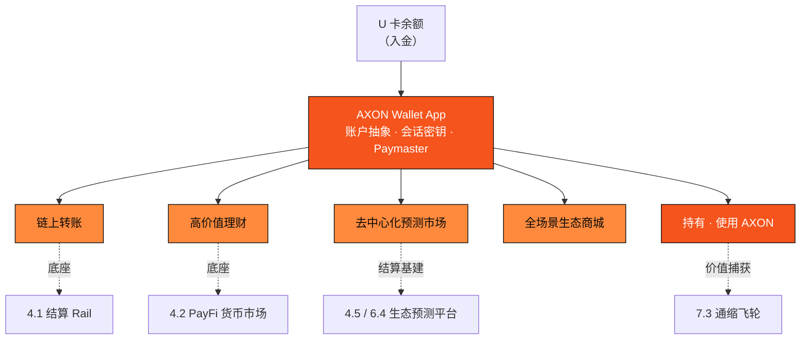

# 4.7 AXON Wallet App：链上转账 · 高价值理财 · 去中心化预测市场

[4.6](4-6-u-card.md) 的 U 卡（PayFi 1.0）把法币变成了卡内的链上稳定币。但一张卡只能「花」，不能「用」——它无法让余额去转账、去生息、去参与链上市场。**AXON Wallet App 就是那个把 U 卡余额激活为可编程链上资本的中枢**：它是整条生态产品线的操作系统，也是普通用户与 AXON L1 之间唯一需要打开的那扇门。

Wallet App 与**全场景生态商城消费**一起，共同构成 AXON 第二个生态 **PayFi 支付生态的 2.0**——如果说 U 卡（PayFi 1.0）解决了「一张卡怎么花」，那么 PayFi 2.0 解决的是「余额怎么在全场景里被真正用起来」。

> **AXON Wallet App 把 U 卡里静止的余额，变成可转账、可生息、可参与市场的可编程链上资本——它是 AXON 生态的超级应用中枢。**

Wallet 建立在 [3.7 账户抽象、会话密钥与 Paymaster](../part3-architecture/3-7-account-abstraction.md) 之上：用户看到的是一个熟悉的余额与「一键」按钮，底层则是账户抽象钱包、会话密钥授权与费用代付——**无助记词负担、无 gas 感知、秒级终局**。它把链上转账、高价值理财、预测市场、全场景生态商城消费，乃至母币 AXON 的持有与使用，收拢进同一个账户入口——是一个**数字银行级的一站式金融超级应用**：如同数字银行把账户、理财、支付与生活服务装进一个 App，AXON Wallet 把整条 PayFi 生态装进一个入口。以下逐一来看它的核心能力。

## 一、链上转账：秒级、无 gas 感的价值流动

转账是 Wallet 最基础、也最高频的能力，它直接复用 [4.1 稳定币即时结算 Rail](4-1-settlement-rail.md)：向地址或人类可读的域名收款、亚秒最终性、7×24 全球到账。gas 由 Paymaster 代付，用户端的一次转账体验成本约为

$$C_{\text{user}} = f_{\text{spread}} + \underbrace{f_{\text{gas}}}_{\to 0 \,(\text{Paymaster})} \approx f_{\text{spread}}$$

也就是说，转账在用户侧几乎「只有意图、没有摩擦」——这正是把 [3.4 支付最终性](../part3-architecture/3-4-payment-finality.md) 做进地基所换来的体验红利。

## 二、高价值理财：闲置稳定币的真实支付流生息

Wallet 内的**理财**，本质是把 [4.2 PayFi 货币市场](4-2-money-market.md) 的收益能力，用一个「一键」交互交付给普通用户：用户把闲置的稳定币投入 PayFi 货币市场 / 浮存金池，份额按**净值（NAV）** 计息。若第 $i$ 段区间的实现收益率为 $r_i$、时长为 $\Delta t_i$，则净值累积为

$$NAV_t = NAV_0 \cdot \prod_i \left(1 + r_i \, \Delta t_i\right)$$

这里的 $r_i$ **不是一个被承诺的固定数字**，而是由底层真实支付流内生、随市场浮动的实现收益率——它的正当性来自 [4.4 货币时间价值](4-4-time-value-of-money.md)：资金需求方为「提前拿到现金」支付的时间价值溢价。收益扎根于真实应收账款与支付流，而非新入场者的本金，**从设计上排除庞氏结构**；风险由 [4.2](4-2-money-market.md) 的风控瀑布（押金 → 准备金 → 逐级吸收）与 [3.5](../part3-architecture/3-5-oracle-safety.md) 的喂价安全共同守护。

> **口径说明**：理财功能是货币市场收益的零售化界面。$r_i$ 为**浮动、内生、非承诺**的实现收益率，Wallet **不提供保本、保底、固定年化或「稳赚」表述**；收益可能因市场与违约情形而波动，本金存在风险，具体产品参数 `待定/治理定`。

## 三、去中心化预测市场：AXON 结算，生态平台承载

Wallet 内直连 AXON **开放生态**里的去中心化预测平台（Polymarket、Kalshi、Kairos **等**，见 [4.5](4-5-copy-trading-engine.md)、[6.4](../part6-roadmap/6-4-ecosystem-season.md)）：用户用稳定币参与事件市场，而**每一笔下注、赔付与结算的最终性都落在 AXON L1**。这厘清了一条边界——**AXON 是这些市场的结算基建与账户底座，预测平台是生态参与方；AXON 不自营博彩、不做庄**。

从机制上看，一个自动做市（LMSR，Logarithmic Market Scoring Rule）的预测市场，其做市成本函数与结果定价为

$$C(\vec q) = b \ln \sum_i e^{q_i / b}, \qquad p_i = \frac{e^{q_i / b}}{\sum_j e^{q_j / b}}$$

其中 $\vec q$ 是各结果的持仓向量、$b$ 是流动性参数。$p_i$ 恰好构成一组和为 1 的概率——**预测市场的价格，就是群体对事件发生概率的共识**。AXON 的价值不在于定义这些市场，而在于为它们提供一个亚秒终局、反双花、可审计的结算层：让「共识定价」这件事，第一次跑在一条为支付而生的确定性地基上。

## 全场景生态商城：把消费铺满全场景

如果 U 卡把稳定币带到了线下刷卡与本地扫码，**全场景生态商城**则把消费半径进一步扩展到生态内的全场景商品与服务——从数字商品、订阅服务，到生态合作商户的实物零售。用户用 Wallet 里的稳定币余额一键结账，结算在 AXON L1 亚秒终局（[4.1](4-1-settlement-rail.md)），gas 由 Paymaster 代付。

商城补齐了「持有稳定币」与「使用稳定币」之间的最后一段距离：一笔成交额为 $G$ 的商城消费，直接转化为链上真实支付流量，按协议费率 $\tau$ 贡献手续费 $\text{Fee} = G \times \tau$，汇入 [7.3 通缩飞轮](../part7-tokenomics/7-3-utility-flywheel.md)。**U 卡负责入金与线下消费、商城负责生态内全场景消费、Wallet 负责把余额用活——三者合起来，才是完整的 PayFi 2.0。**

## 母币 AXON：生态的原生货币，在钱包里被持有与使用

一个完整的金融超级应用，还需要一种把整条生态串起来的原生货币——这就是母币 **AXON**（见 [Part VII 代币经济](../part7-tokenomics/README.md)）。Wallet App 正是用户**持有与使用 AXON** 的入口：在钱包里，用户可以持有 AXON，并把它用于生态——**以 AXON 支付链上手续费可享阶梯折扣、质押 AXON 参与网络安全与治理、作为 PayFi 与 AI 代理场景的信誉押金**。

AXON 在这里不是一个孤立的投机标的，而是**生态的原生货币与权益凭证**：U 卡消费、商城成交、理财与转账所产生的真实手续费，经 [7.3 通缩飞轮](../part7-tokenomics/7-3-utility-flywheel.md) 回购并销毁 AXON——**生态里被使用得越多，飞轮转得越快**。这把「用户在钱包里的日常金融行为」与「母币的长期价值捕获」直接接通：稳定币负责流动与消费，AXON 负责承载整条生态的安全、治理与价值回流。

> **口径说明**：本节描述 AXON 的**效用与持有 / 使用场景**，**不涉及价格、市值、发行或投资回报**；代币的分配、解锁与流通口径以 [Part VII](../part7-tokenomics/README.md) 为准，初始价 / FDV / TGE 流通比例不予披露。持有与使用 AXON 存在市场与合规风险，具体开放范围以合规上线口径为准。

## 四位一体：Wallet 让价值在生态内循环

转账、理财、预测、商城消费与母币 AXON 的持有使用，在同一个账户里打通后，资本可以在生态内无摩擦流转：U 卡入金 → Wallet 转账/理财 → 闲时生息 → 参与预测市场 → 商城消费 → 结算回稳定币余额 → 再消费，其间产生的手续费经飞轮回购并销毁 AXON。每一次流转都是一笔真实 TPV，按协议费率并入 [7.3 通缩飞轮](../part7-tokenomics/7-3-utility-flywheel.md)。**Wallet 不是若干功能的拼贴，而是让价值在 AXON 生态内持续循环、持续为 L1 与母币 AXON 沉淀真实业务量的中枢。**

> **口径说明**：本节为 `proposed design`，对应路线图 P1（转账 + 理财 MVP）→ P2（货币市场规模化、预测市场直连）阶段（[6.1](../part6-roadmap/6-1-roadmap.md)）。预测市场为生态平台承载、AXON 提供结算基建，非 AXON 自营；相关功能的地区开放范围以合规上线口径为准。

---

*延伸阅读：[4.2 PayFi 货币市场](4-2-money-market.md) · [4.5 美股带单引擎](4-5-copy-trading-engine.md) · [4.8 金融社交生态](4-8-financial-social.md)*
