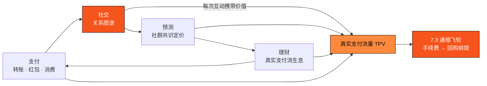

# 4.8 金融社交生态：完整的金融社交闭环

U 卡（[4.6](4-6-u-card.md)）解决了「钱怎么进来、怎么花出去」，Wallet（[4.7](4-7-wallet-app.md)）解决了「钱怎么转、怎么生息、怎么参与市场」。剩下最后一块拼图，是把这些原本孤立的金融动作，接进人与人的**关系网络**——这就是 AXON 的**金融社交生态**，也是整条产品线最外层、最具想象力的一环。

本节对应 AXON 生态弧线的最高两层：**生态三 · 金融社交超级生态**——把金融与社交融进同一结算层；以及 **生态四 · 聊天社交软件**——把这层生态收束为一款独立产品，是最远期的一层（生态开放弧线见 [6.1](../part6-roadmap/6-1-roadmap.md)）。

> **支付，本就是社交的原语。** 钱在人与人之间流动，本身就画出了一张关系图谱——谁给谁付过款、谁跟了谁的单、谁和谁在同一个预测圈子里。AXON 要做的，是把这张图谱从各家 App 的孤岛里解放出来，让它直接生长在一条为支付而生的结算层上。

在传统世界里，社交（微信、Instagram）与金融（银行、券商）是两套割裂的系统：关系在一个 App 里，钱在另一个 App 里。而当支付本身变成亚秒终局、无 gas 感的原子操作（[4.1](4-1-settlement-rail.md)、[3.7](../part3-architecture/3-7-account-abstraction.md)），社交与金融第一次可以在同一层里融合——**每一次互动都可以携带价值，每一笔价值流动都天然带着社交属性**。

## 金融社交的四种形态

* **社交转账 / 红包 / 打赏**——把 P2P 支付变成一种社交表达：群里发红包、给创作者打赏、朋友间 AA。它是支付原语的社交化包装，不是博彩。
* **带单与策略分享**——[4.5 美股带单引擎](4-5-copy-trading-engine.md) 天然是社交放大器：用户可以在社交图谱里跟随、分享、讨论策略表现，让「地基先行、生态切口」的第一批流量沿着关系链自然扩散。
* **预测市场的社群共识**——[4.7](4-7-wallet-app.md) 的预测市场（[4.5](4-5-copy-trading-engine.md)/[6.4](../part6-roadmap/6-4-ecosystem-season.md)）本质是群体对事件的定价，社群是它最自然的载体：观点在圈子里碰撞，共识在链上定价。
* **圈子内的共同理财**——把 [4.2 货币市场](4-2-money-market.md) 的生息能力放进社群语境，让一群人以透明、可审计的方式共同参与真实支付流生息（收益口径同 [4.7](4-7-wallet-app.md)，浮动、非承诺）。

## 四位一体：支付 · 理财 · 预测 · 社交的闭环

支付带来关系、关系带来预测与理财、金融行为又反过来加密关系的粘性——四者互为入口、互相强化，构成一个持续自转的闭环。而这个闭环的每一次转动，都在为 AXON 沉淀真实业务量。

## 网络效应：为什么社交是价值的放大器

金融社交的价值，来自网络效应。一个有 $n$ 个活跃金融关系的网络，其价值可以用一个保守的 Metcalfe 变体来刻画：

$$V \propto n \log n$$

也就是说，用户规模的增长会带来**超线性**的网络价值增长——这正是「社交为公链赋能」的数学直觉：每多一个用户，不只多一份消费，更多出与既有用户之间的一整圈潜在价值流动。

这份放大直接体现在飞轮的入口上。社交层贡献的增量手续费为

$$\text{Fee}_{\text{social}} = \text{TPV}_{\text{social}} \times \tau$$

其中 $\text{TPV}_{\text{social}}$ 是社交场景驱动的支付流量、$\tau$ 是协议费率。它与 U 卡消费、Wallet 理财与转账的 TPV 一同汇入 [7.3 通缩飞轮](../part7-tokenomics/7-3-utility-flywheel.md)。若进一步用增长模型刻画传播，社交裂变的病毒系数（K 因子）可写为 $K = i \times c$（$i$ 为人均邀请数、$c$ 为转化率），当 $K > 1$ 时网络进入自增长区间——这是一个**前瞻性的增长假设**，用以说明社交层对生态规模的杠杆，而非任何承诺。

## 生态四 · 聊天社交软件：把金融社交收束为一款产品

金融社交的能力，可以先内建进 Wallet 与生态商城（生态三）；但它的完整形态，是一款**独立的聊天社交软件**——AXON 生态弧线最远期的一层（生态四）。在这款产品里，聊天与转账是同一个动作、群组与分账是同一个界面、关系链与资金流是同一张图：**发一条消息可以顺手转一笔钱，建一个群可以顺手开一场共同理财或一次预测，关注一个人可以顺手跟他的单。** 金融不再是社交之外的另一个 App，而是社交本身的一种表达。

这一层把前几层沉淀的支付、消费、理财、预测能力，全部收拢进一个以人为中心的入口，真正打造出用户的**金融社交完整生态**，也为整条弧线画上句点。作为最远期的规划，它以 `proposed design` 呈现，对应路线图 P3+（[6.1](../part6-roadmap/6-1-roadmap.md)）。

## 完整生态：从地基到超级应用

至此，AXON 的叙事闭合成一条完整弧线：**L1 地基（Part III）→ PayFi 引擎（4.1–4.4）→ 生态一 · 带单（4.5）→ 生态二 · PayFi 支付（U 卡 · 商城 · Wallet，4.6–4.7）→ 生态三 / 四 · 金融社交与聊天社交（4.8）**。地基把确定性做进底层，引擎把时间价值搬上链，一层层生态把这一切送到亿级用户的口袋、日常与关系里。金融社交是这条弧线的收束——它让 AXON 不只是一条链，而是一个**支付、理财、预测、社交四位一体的完整金融社交生态**，持续地为母币 AXON 赋能。

> **口径说明**：本节为整条产品线中最远期的 `proposed design`，对应路线图 P3+ 阶段（[6.1](../part6-roadmap/6-1-roadmap.md)）。社交转账/红包/打赏为支付原语的社交化表达，**非博彩、非收益产品**；带单与理财分享沿用 [4.5](4-5-copy-trading-engine.md)/[4.7](4-7-wallet-app.md) 的合规口径（浮动、非承诺、排除庞氏）；$V \propto n\log n$ 与 K 因子为**设计假设 / 前瞻模型**，用于说明网络效应，不构成任何增长或收益承诺。

---

*延伸阅读：[7.3 代币效用与通缩飞轮](../part7-tokenomics/7-3-utility-flywheel.md) · [6.1 路线图 P0 → P3+](../part6-roadmap/6-1-roadmap.md) · [Part V · AI 原生](../part5-ai/README.md)*
