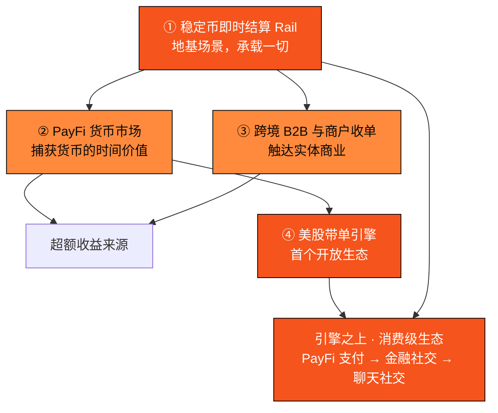

# Part IV · PayFi 引擎

> 一条支付 rail 打底，四个场景层层叠加价值。

Part III 建好了地基。本部分展示地基之上生长出的业务：**PayFi 的四大场景**，以及引擎之上的**消费级超级应用矩阵**。

这四个场景不是并列的四个功能，而是一个**层层叠加的价值结构**——底层是结算 rail，它承载一切；在其上叠加货币市场，捕获时间价值；再叠加跨境与商户场景，触达实体商业；而 AI 代理支付（Part V）则贯穿其中，成为机器时代的支付方式。

而在这四大场景之上，AXON 按**生态开放的顺序**层层展开一整套面向亿级用户的消费级生态：**生态一** 是首个开放生态、且已开放的**美股带单引擎**（[4.5](4-5-copy-trading-engine.md)）；**生态二** 是 **PayFi 支付生态**——1.0 为 **Crypto U 卡支付**（[4.6](4-6-u-card.md)），2.0 为 **全场景生态商城消费 + AXON Wallet App**（[4.7](4-7-wallet-app.md)）；再往上是 **生态三 · 金融社交超级生态** 与 **生态四 · 聊天社交软件**（[4.8](4-8-financial-social.md)）。如果说 4.1–4.5 是把价值做进地基与引擎，那么 4.6–4.8 就是把价值一路送到用户的口袋、日常与关系里，让「地基先行、产品切口」从基建走向日用。生态开放的完整弧线与阶段映射见 [6.1 路线图](../part6-roadmap/6-1-roadmap.md)。

本部分的章节地图：

* **4.1** 稳定币即时结算 Rail —— 承载一切的地基场景。
* **4.2** PayFi 货币市场 —— 浮存金与链上信贷，PayFi 的超额收益来源。
* **4.3** 跨境 B2B 与商户收单 —— 让 PayFi 触达实体商业。
* **4.4** 货币时间价值的金融学 —— 支撑这一切的金融第一性原理。
* **4.5** 美股带单引擎 —— **生态一**：AXON 首个开放生态（已开放），把上述地基能力兑现成可被市场感知的落地场景。
* **4.6** Crypto U 卡 —— **生态二 · PayFi 1.0**：把链上稳定币变成口袋里的购买力，触达现实世界消费的最后一公里。
* **4.7** AXON Wallet App —— **生态二 · PayFi 2.0**：全场景生态商城消费 + 链上转账 / 高价值理财 / 去中心化预测市场三合一的生态超级应用中枢。
* **4.8** 金融社交生态 —— **生态三 / 四**：支付、理财、预测、社交四位一体的金融社交超级生态，并延伸到独立聊天社交软件，收束完整闭环。
